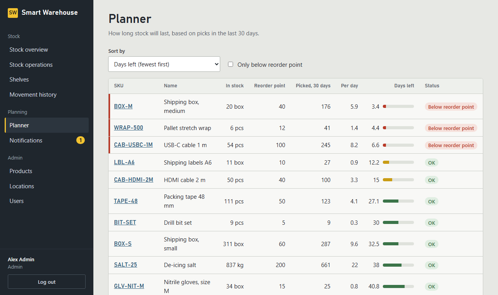
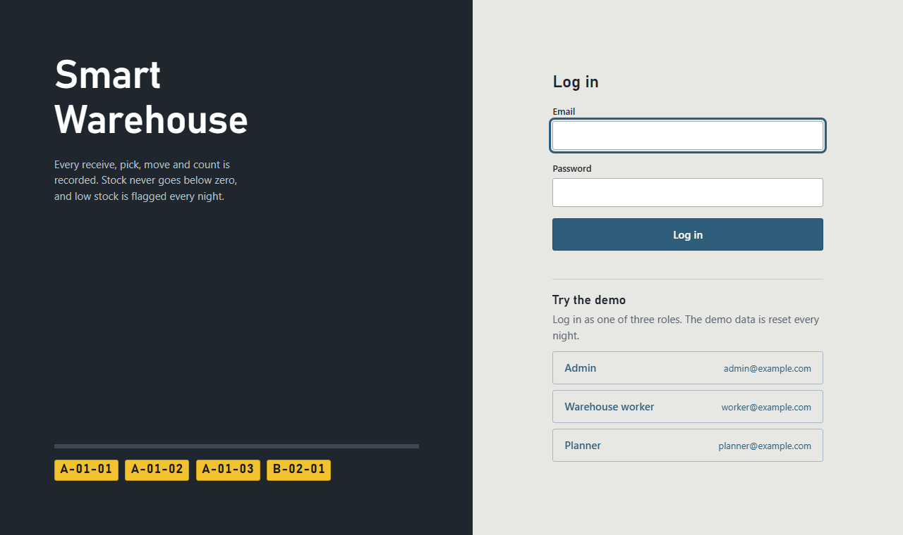
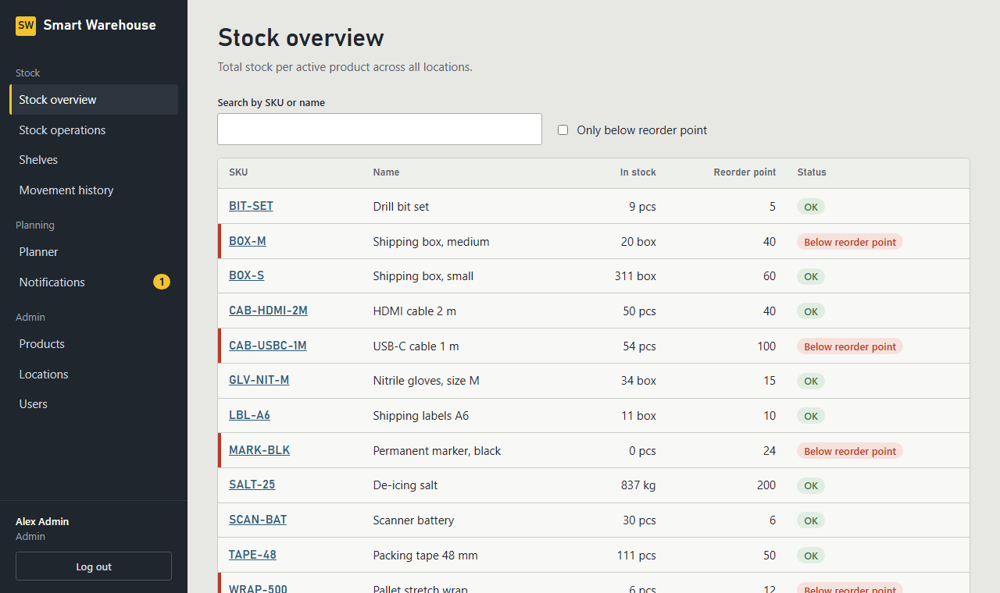
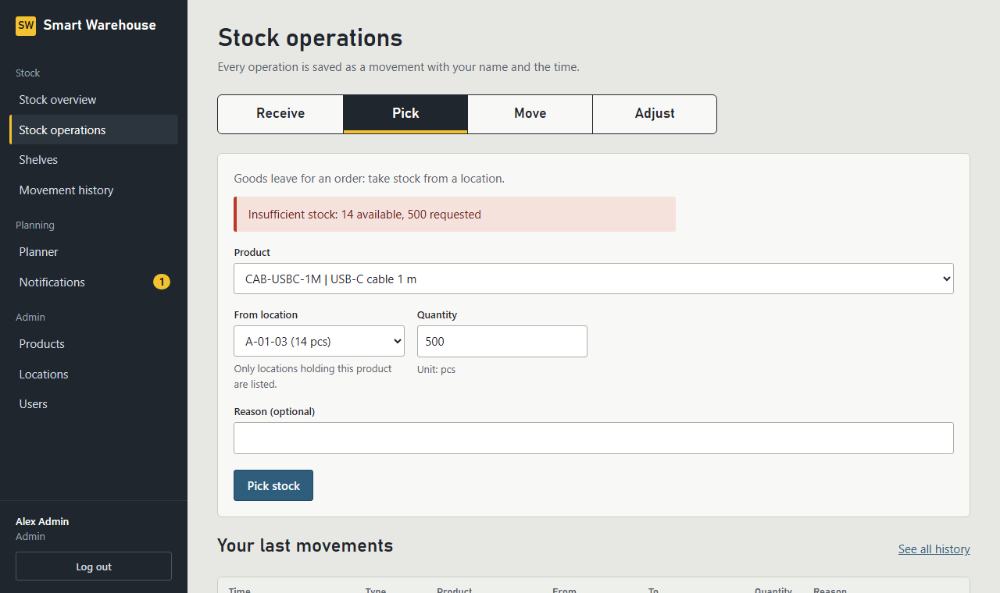
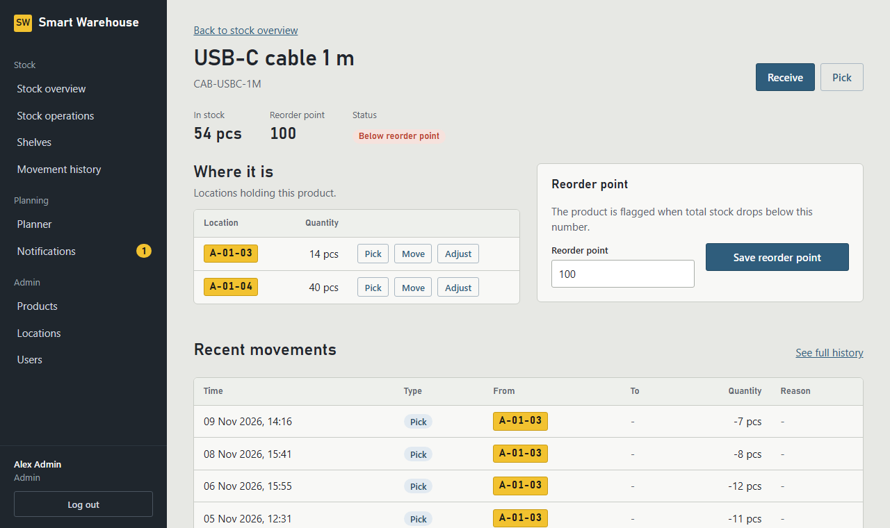

# Smart Warehouse Management

A warehouse stock system for a small warehouse: every receive, pick, move and count is recorded,
stock can never go below zero (even when two people pick the last item at the same moment), and
products that are running low are flagged every night.

**Live demo:** https://smart-warehouse-management-production.up.railway.app (log in with one click as admin, worker or planner; the demo resets every night)



## What it does

| Role | Can |
|---|---|
| **Warehouse worker** | Receive, pick, move and adjust stock; look up any product or shelf; print a count sheet for a shelf |
| **Planner** | See average daily usage and days of stock left; change reorder points; get the nightly low-stock alert |
| **Admin** | Everything above, plus manage users, products and locations |

- **Every stock change is a movement** with user, time and reason. Movements are never edited or deleted; a correction is a new adjustment.
- **No negative stock.** The database transaction locks the stock row; a `CHECK (quantity >= 0)` constraint is the final safety net.
- **Light planner.** Usage = picks in the last 30 days; days left = stock ÷ average daily usage.
- **Nightly low-stock alert.** One in-app notification per admin and planner, and a product is not alerted again until it has been restocked.

| | |
|---|---|
|  |  |
|  |  |

## Tech stack

| Area | Choice |
|---|---|
| Backend | Python 3.14, FastAPI, Pydantic v2 |
| Database | PostgreSQL 17, SQLAlchemy 2.0, Alembic (5 migrations) |
| Auth | JWT (HS256, 60 min), bcrypt, role checks on every route, login rate limit |
| Background job | APScheduler inside the app (02:00 UTC low-stock check) |
| Frontend | Plain HTML, CSS and JavaScript modules: no framework, no build step, strict CSP |
| Tests | pytest against a real PostgreSQL, Playwright browser tests, coverage ≥ 95% enforced |
| Delivery | Docker, Docker Compose, GitHub Actions on every push, Railway |

## Architecture

```
Browser (app/static: HTML + JS modules)
   │  same origin, JWT in sessionStorage
   ▼
FastAPI  ── security headers (CSP, HSTS) ── rate limit on /auth/login
   │
   ├─ routers/      HTTP: schemas, roles (require_roles), status codes
   ├─ services/     warehouse rules: movements, locking, planner, alerts  (no HTTP)
   ├─ models/       users, products, locations, inventory, stock_movements, notifications
   └─ scheduler     02:00 UTC low-stock check  (+ 03:00 demo reset in demo mode)
   │
   ▼
PostgreSQL  ── constraints: quantity >= 0, unique SKU / code, valid movement directions
```

More detail: [project structure](docs/project-structure.md) · [data model](docs/data-model.md) ·
[API endpoints](docs/api-endpoints.md) · [transaction flows](docs/transaction-flows.md) ·
[security review](docs/security-review.md) · [deploying](docs/deploy.md)

## Key design decisions

**Row locking, in a fixed order.** A pick runs `SELECT … FOR UPDATE` on the inventory row before
it checks and changes the quantity, so a second pick of the same item waits and then sees the new
number. A move locks both rows lowest `location_id` first, so two opposite moves can't deadlock.
`tests/test_concurrency.py` starts two threads at the same instant (a `Barrier`) and proves that
exactly one of two picks of the last item succeeds.

**One transaction per operation.** The inventory change and the movement record are committed
together or not at all, so the history always explains the stock.

**409 vs 422.** 422 means the request itself is wrong (bad field). 409 means the request is fine
but the current state says no (not enough stock, duplicate SKU, shelf still holds stock).

**404 instead of 403 for someone else's notification.** The API doesn't reveal that an id exists
if it isn't yours.

**Idempotent alerts.** The nightly job flags a product when it alerts and clears the flag when the
product is restocked, so running it twice never duplicates a notification.

**The backend is the security.** The frontend hides menu items by role, but every route checks
the role itself. API data only reaches the page via `textContent`, and a strict Content Security
Policy blocks inline scripts. Tests fail if a page ever adds inline JS or uses `innerHTML`.

**Rate limiting behind a proxy.** Behind Railway every request comes from the proxy's IP, so the
login limit keys on the last `X-Forwarded-For` hop, which the proxy adds. Earlier hops are
client-controlled and ignored.

## Run it locally

Needs Docker and Python 3.14.

```powershell
git clone https://github.com/Amirrabah/smart-warehouse-management.git
cd smart-warehouse-management
copy .env.example .env          # then set POSTGRES_PASSWORD, DATABASE_URL and JWT_SECRET
py -c "import secrets; print(secrets.token_hex(32))"   # a JWT_SECRET

docker compose up --build       # API + database on http://localhost:8000
```

Create the first admin (in another terminal):

```powershell
docker compose exec -e ADMIN_EMAIL=you@example.com -e ADMIN_PASSWORD=choose-a-password api python -m app.seed
```

Or try it with demo data: set `DEMO_MODE=true` in `.env` and start with an **empty** database
(`docker compose down -v`, then `up`). The login page then shows one-click demo logins.
Never use demo mode for real data: it wipes everything every night.

## Tests

```powershell
py -m venv .venv; .venv\Scripts\activate
py -m pip install -r requirements-dev.txt
py -m playwright install chromium
docker compose up -d db
py -m alembic upgrade head
py -m pytest --cov
```

362 tests, 99% line coverage. They run against a real PostgreSQL (a separate `_test` database),
including the concurrency tests and browser tests for each role. CI runs Ruff, the migrations
and the full suite with a 95% coverage floor on every push.

## Known limits

- Logout only forgets the token in the browser; a token stays valid until it expires (60 minutes).
- The nightly job and the rate-limit counters live in the app process: run one instance.
- Out of scope for version 1: purchase orders, suppliers, forecasting, several warehouses, barcode scanning, email alerts.

See [the security review](docs/security-review.md) for the full list of accepted risks.
