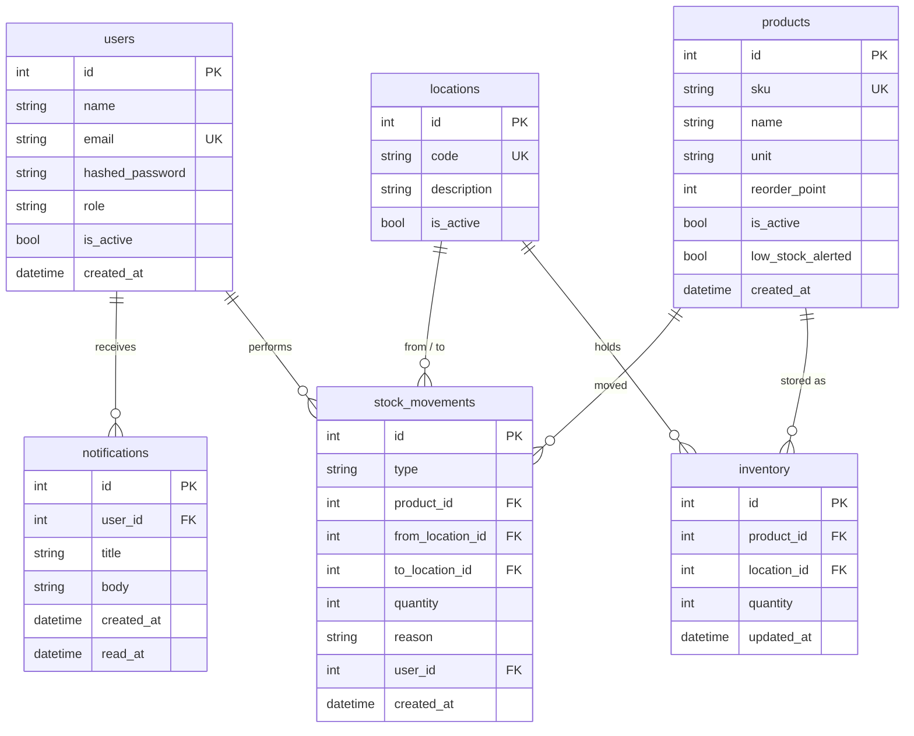

# Data model

## Database rules

| Table | Rules |
|---|---|
| `users` | email `UNIQUE`; role `CHECK IN ('admin', 'worker', 'planner')` |
| `products` | sku `UNIQUE`; unit `CHECK IN ('pcs', 'box', 'kg')`; reorder_point `>= 0`; sku and unit not editable after creation |
| `locations` | code `UNIQUE`; format `A-01-03` validated in the API |
| `inventory` | `UNIQUE (product_id, location_id)`; `quantity >= 0`; rows at zero are kept |
| `stock_movements` | `quantity > 0`; type `CHECK IN ('receive', 'pick', 'move', 'adjust')`; from/to rules below |
| `notifications` | `user_id` required (FK to users); `read_at` empty means unread; index on `(user_id, read_at)` |

## Movement rules

Every movement has a positive quantity. The direction comes from the locations:
`from_location` is where stock is removed, `to_location` is where stock is added.

| Type | from | to | Reason |
|---|---|---|---|
| receive | — | required | optional |
| pick | required | — | optional |
| move | required | required (different from `from`) | optional |
| adjust | exactly one of from / to | | **required** |

Applying a movement: subtract from `from` if set, add to `to` if set.
`inventory` (current stock) and `stock_movements` (history) are always written in one transaction.

## Notifications

Notifications are per user. The nightly low-stock job creates one notification for each active admin and planner, so every person has their own inbox and marks their own notifications as read.

## Low-stock alerts

`products.low_stock_alerted` is set when an alert is sent. The same nightly job clears it once stock is back above the reorder point, so a product is not alerted twice for the same shortage, but alerts again if it runs low later.
